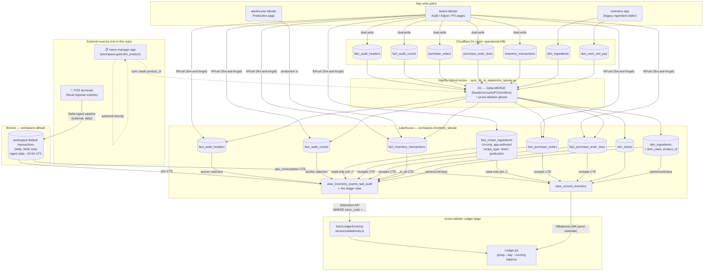
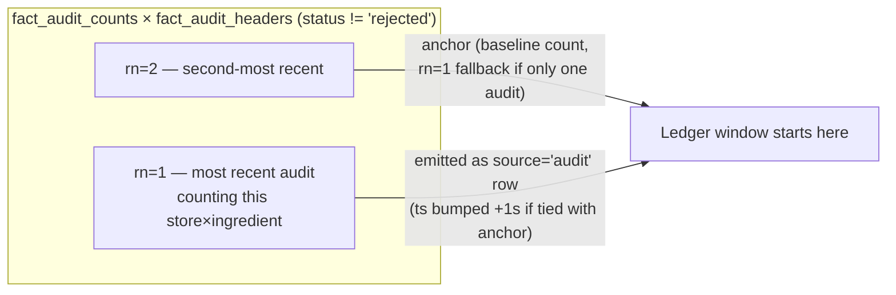
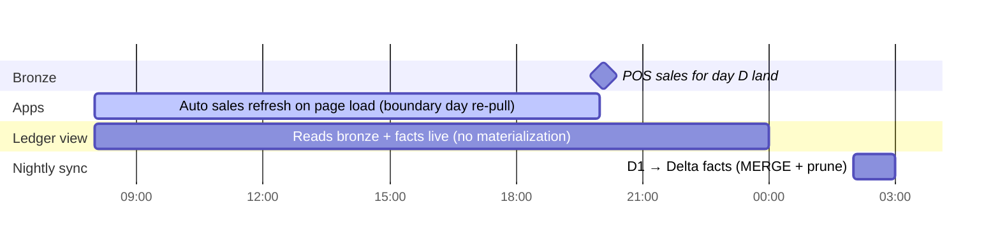

# Daily Ledger — Data Lineage Audit (stores-tabular)

**Date:** 2026-11-15 · **Scope:** the Ledger tab of `apps/stores-tabular` — how its daily
rows are calculated, which tables/views feed them, and which filters apply at each hop.
Trigger: `Моти Банан в шоколаде` shows zero sales in the app while bronze has sales
(1 шт on Nov 13 + 4 шт on Nov 14, RSQ) — root cause identified in §7.

---

## 1. Lineage map (full path)



---

## 2. The ledger view — `view_inventory_events_last_audit`

Single source of truth for the Ledger tab. Source of record:
`scripts/lakehouse_sql/view_inventory_events_last_audit.sql` (the live view was created
from it via `CREATE OR REPLACE VIEW … WITH SCHEMA COMPENSATION`).

### 2.1 Anchor selection (the cutoff rule)

The ledger covers the **previous audit interval**, not "since the last audit" — the last
audit itself is emitted as a row so the day it happened shows its correction:



Details:
- `latest_audit` = `fact_audit_counts ⋈ fact_audit_headers WHERE h.status != 'rejected'`,
  row-numbered per `store_id × ingredient_id` by `audit_date DESC, audit_id DESC`.
- **Anchor = rn=2** (baseline count). If the pair has only one audit, anchor = rn=1.
- **rn=1 audit** is emitted as `source='audit'` with `qty_change = NULL`, only when it is
  not the anchor itself (`a.audit_id != l.audit_id`). Its `event_ts` is bumped **+1 second**
  over the anchor when timestamps tie (legacy audits share the fallback `T23:59:59`).
- Timestamp fallback: when `audit_timestamp` doesn't start with `audit_date`, the event
  time becomes `audit_date T23:59:59`.

### 2.2 Event sources (each is a UNION branch)

| # | source | from | join/conditions | emitted qty_change |
|---|--------|------|-----------------|--------------------|
| 1 | `audit` (anchor) | anchor_picked (rn=2 / rn=1 fallback) | — | NULL (count in `audit_count`) |
| 2 | `audit` (last) | anchor_last (rn=1) | only if it isn't the anchor; ts > anchor (bumped +1s if tied) | NULL (count in `audit_count`) |
| 3 | `pos_sale` | `workspace.default.transactions` | `recipe_product_name = product AND recipe_type='retail'` — **exact spelling join** | `-(qty × amount_per_serving)` per recipe ingredient |
| 4 | `po_receipt` | fact_purchase_orders ⋈ lines | `status IN ('received','partially_received')` AND not already in fact_inventory_transactions AND **not an inter-store transfer** (`NOT (from_store_id IS NOT NULL AND to_store_id IS NOT NULL)`) | `received_quantity` else `ordered_quantity` |
| 5 | `transfer_in` / `transfer_out` / `inventory_tx` | fact_inventory_transactions | LEFT JOIN POs: PO with both from+to ⇒ transfer; qty<0 ⇒ out | `quantity` as-is |

### 2.3 Filters (SQL-side)

| Where | Filter | Effect |
|---|---|---|
| bronze→pos CTE | `NOT COALESCE(is_return, FALSE) AND qty > 0` | returns excluded, gross sales only |
| bronze→pos CTE | `CASE store_name … END AS store_id` + `WHERE store_id IS NOT NULL` | 10 known stores map to ids; unknown store names silently dropped |
| bronze→pos CTE | `recipe_type='retail'` exact-name join | **products without a retail recipe row produce NO sale events** (see §7) |
| all movement branches | `event_ts > anchor.event_ts` | nothing before the anchor enters the ledger |
| audit branches | `h.status != 'rejected'` | rejected audits invisible |
| receipts | `tx.po_id IS NULL` | POs already confirmed by an inventory transaction don't double-count |
| final SELECT | join `dim_stores`, `dim_ingredients` | display names/unit; **no `is_active` filter here** (that filter exists only in `view_current_inventory`) |

### 2.4 Store id map (hardcoded in the view)

`НОВО КП=1, ГРИН ПАРК=2, БОН ПАССАЖ=3, ЧЕРНОМОРСКИЙ=4, СОВЕТОВ=5, ГАЛЕРЕЯ=6, ОЗМОЛЛ=10, АНАПА=11, ГЕЛЕНДЖИК=12, КИОСК=13`.

---

## 3. App side — what the Ledger page does with the events

`apps/stores-tabular/src/pages/Ledger.jsx`, fetch in `services/databricks.js::fetchLedgerEvents`:

```sql
SELECT … FROM workspace.inventory_tabular.view_inventory_events_last_audit
WHERE store_code = '<selectedStore>'      -- single filter app-side
ORDER BY event_ts ASC
```

Client-side processing (`Ledger.jsx`, lakehouse path — authoritative; a legacy local
computation from D1 audits + sales cache runs only if the fetch fails):

1. **Filter** events to the selected `ingredient_id` (left panel) — the store filter
   happened in SQL.
2. **Anchor** = first `source='audit'` row (the rn=2 baseline); its `audit_count` is the
   starting balance; any event with `event_ts <= anchor_ts` is dropped.
3. **Group by date**, sort by time inside the day; classify each event into a row kind:
   `audit` (adj = counted − running), `sale` (`consumed = −qty_change`), `po`,
   `transfer-in/out`, `production-yield/usage`, `adjustment`.
4. **Running balance** replayed day by day: sales/waste/production-usage subtract;
   receipts/transfers-in/adjustments/production-yield add; audits reset to count.
5. **Display filter:** `date ∈ [from, to]` AND day has activity
   (`usage>0 || received≠0 || transfers || auditAdj≠null || baseline || date==today`),
   newest first.

> ⚠ Display nuance: a day with only sale events where the mapped consumption is `0`
> (e.g. `amount_per_serving = 0` or no retail row at all) is filtered out by the
> "has activity" rule — the sale becomes invisible even if the event existed.

---

## 4. Upstream table population (who writes what)

| Lakehouse table | Writer | Cadence | Notes |
|---|---|---|---|
| `workspace.default.transactions` (bronze) | **External Delta ingest pipeline** (not in repo; daily `DELETE`+`WRITE` commits at ~20:04 UTC) | daily | day *D*'s sales become visible in the ~20:04 UTC commit of day *D* (verified by time travel: v667=Nov 13, v669=Nov 14) |
| `fact_audit_headers` / `fact_audit_counts` | nightly sync (D1 verbatim MERGE) + app `lhPush` | nightly + on write | sync **prunes LH ghosts absent from D1** (deletion resurrection fix) |
| `fact_purchase_orders` / `…_lines` | nightly sync (D1) + app `lhPush` | nightly + on write | |
| `fact_inventory_transactions` | nightly sync (D1, append-only merge) + app `lhPush` | nightly + on write | adjustments/production/transfers |
| `fact_recipe_ingredients` | **app-authored directly in LH** (`LH_PUSH.recipeReplace` / `recipeReplaceRetail` from stores-tabular & warehouse-tabular Recipes tabs) | on save | **not** synced from D1 anymore |
| `dim_ingredients` | nightly sync from D1 `dim_ingredients` (edited in inventory-app), then reclassified: `item_class` + `product_id` via `echelon_semantics.py` (incl. `NAME_PRODUCT_ID_PINS` — `Моти банан-шоколад → 370`) | nightly | |
| `dim_stores` | hardcoded spec in the sync script | nightly | RSQ(1), GPK(2), BON(3), CHM(4), GAL(6) active |
| `dim_cook_unit_pay` | nightly sync from D1 + app `lhPush` | nightly + on write | |
| `gold.dim_product` | **menu-manager** (separate app, direct LH writes) | on save | read by sync for product_id resolution and by Recipes tab |

### Refresh timeline (typical day)



---

## 5. Balance views that share the lineage

`view_current_inventory` (left panel estimate + PO suggestions) shares the same
bronze→retail-join pattern:

```
current_on_hand = audit_quantity(rn=1)
                + net_movement_since_audit        -- fact_inventory_transactions
                − pos_consumption_since_audit     -- bronze ⋈ recipe_type='retail' ⚠
                + po_receipts_since_audit         -- fact_purchase_order_lines
WHERE s.is_active                                 -- active stores only
```

Same consequence as §7: finished goods without retail rows show **flat audit-count
balances** between audits — sales never deplete them (verified: RSQ `Моти банан-шоколад`
id=172 stays 5.0 as of 2026‑11‑12 despite 5 units sold Nov 13–14).

---

## 6. Filters quick-reference (audit trail)

| Hop | Filter | File / location |
|---|---|---|
| bronze rows | `is_return = false`, `qty > 0` | view pos CTE + `api.js::fetchDatabricksSales` |
| bronze rows (app sales cache) | `store_name ∈ STORES` (fakeData list) | `ConfigContext.jsx::rowsToSales` |
| ledger fetch | `store_code = selected` | `databricks.js::fetchLedgerEvents` |
| ledger rows | `event_ts > anchor_ts`, `ingredient_id = selected` | view + `Ledger.jsx` |
| ledger display | date range + "has activity" | `Ledger.jsx` (line ~186) |
| PO receipts | `status IN ('received','partially_received')`, not transfers, not already in tx | view receipts CTE |
| audits | `status != 'rejected'` | view latest_audit CTE |
| current inventory | `s.is_active` | view_current_inventory |

---

## 7. Findings — why `Моти Банан в шоколаде` shows no sales

**Name lineage is clean.** Bronze sells only the canonical spelling
`Моти Банан в шоколаде` (0 rows for the old `Моти банан-шоколад` since normalization);
`dim_product` id=370 carries the identical canonical name; the old spelling survives only
as `dim_ingredients` id=172's display name (pinned to product 370).

**The sales bridge is missing for all finished goods.** The ledger's `pos_sale` branch
and `view_current_inventory`'s `pos_consumption` join POS sales to ingredients via
`fact_recipe_ingredients.recipe_type='retail'` on **exact product-name equality**.
The retail table contains 169 keys — **all drinks/toppings, zero finished-goods rows**.
Mochi/blini sold-as markers were authored as `recipe_type='production'` rows with a
single finished line (`Мoti Банан в шоколаде` → 1.0 × ingredient 172), which both views
ignore.

Consequences (all stem from this one gap):

1. Ledger tab: no `pos_sale` rows for any mochi/blini — only audit anchors and
   transfers appear.
2. `view_current_inventory`: finished balances never deplete between audits.
3. App-local consumption loop (`useInventoryCalcs::salesRecipeFor` over
   `salesRecipes` = retail rows only): 0 consumption → PO suggestions ignore sales.
4. Ledger display filter hides zero-activity days entirely (§3, note).

**Fix direction:** insert retail sold-as rows (`1.0 × the SKU's own ingredient row`) for
the 9 mochi + blini SKUs keyed by canonical POS spelling — the representation the
two-echelon plan's ground truth already prescribes (`POS sale → 1.0 × own SKU`,
`plans/two-echelon-inventory-model.md` line 23).

### Status (2026-11-15, end of session)

- **Deployed (view side, name-based):** both views now also accept production rows whose
  lines are ALL finished (sold-as markers); raw-material BOMs remain excluded. Guarded
  widening instead of a literal filter removal — 11 raw-BOM production keys match live POS
  spellings (mochi BOMs, 3 corndogs, `Блинчики с мясом`, `Печенье с предсказаниями`) and a
  naive drop of `recipe_type='retail'` would have made stores consume WHS-only raws.
- **Verified read-only after deploy (RSQ):** 172 gains exactly its 5 `pos_sale` events
  (−1 Nov 13, −4 Nov 14); `view_current_inventory` 172 depletes `5.0 → 0.0` as of 11‑14;
  drinks unchanged (delta = only finished rows: mochi ×5, `Блинчики с крем-сыром` ×1,
  `Блинчики с нутеллой` ×1 — all on `item_class='finished'` ingredients); zero raw-BOM
  leakage.
- **Drafted, NOT deployed (product_id revision — final, validated):** the deployed join
  still matches recipes by product NAME. `scripts/lakehouse_sql/view_inventory_events_last_audit.sql`
  and `view_current_inventory.sql` (repo) carry the validated product_id revision, agreed
  design = ledger covers EVERY `dim_product` product via three paths:
  (A) retail recipes joined by `product_id`; (B) finished direct link —
  `dim_ingredients.item_class='finished'` row with the same `product_id` depletes 1 шт per
  sale, applied only when the product has NO retail recipe (retail precedence, ROW_NUMBER-deduped);
  (C) NULL-pid pseudo-product recipes (`'Списание - …'`) fall back to a
  normalized-name match, retail-only. Bridge: POS spelling → `gold.dim_product`
  (normalized key, active row preferred) → `product_id`. No sold-as marker recipes needed.
  The ledger's `product` column displays the canonical `dim_product.product_ru` spelling
  (confirmed by user 2026‑11‑15) — case-drifted POS variants collapse into one display row;
  path C spellings have no dim row and keep the raw POS string.
- **Validation (read-only emulation, `scratch/compare_pos_design.py`, window 2026‑11‑01..15):**
  totals OLD 12 702 events / 687 139 units / 108 products → NEW 13 956 / 721 804 / 122.
  Product-level diffs: 429 rows, ALL `old=0 → new>0` (pure coverage gains, no regressions).
  Ingredient-level non-finished diffs: 66 rows, **all GAINs, 0 losses** — fully explained by
  case-drift spellings the exact-name join silently dropped (e.g. GAL `Газированная вода`
  +3960 = `Райский Лимонад` 1920 + `Вишневая кислинка лимонад` 2040; GAL `Сок апельсиновый`
  +1650 = `Манго Танго лимонад (…)` 750 + `Райский Лимонад` 900); units = qty × amount
  exactly; zero double-path matches (no product hits both pid-retail and NULL-pid fallback);
  zero raw-BOM leakage. See `scratch/trace_ing_diffs.py`, `scratch/trace_examples.py`.
- **Still open (data side, not view side):** under the new design the missing sold-as marker
  recipes are no longer needed — finished-goods coverage comes from `dim_ingredients.product_id`
  (19/22 rows OK). Residual edge cases: `Блинчики вишня` (pid=116) and `Мoti Вишня` (pid=5)
  link to INACTIVE dim rows still sold in POS; `Корн-дог Сникерс сладкий` (id=180) has no
  dim link; bronze spellings that resolve to no dim row remain invisible → drift report
  (Phase 3) still required. Nothing was committed to git in this session.

### App-feed views (2026-11-15, deployed + wired)

- **Product_id revision deployed** for `view_inventory_events_last_audit` and
  `view_current_inventory` (statements 01f1e140-…): totals 12 702/687 139/108 →
  13 956/721 804/122, all diffs pure gains (66 ingredient-level gains, 0 losses);
  anchor reconciliation 13 495 live = 13 956 − 461 pre-anchor (by design).
- **Three new app-feed views deployed** (`scratch/deploy_appfeed_views.py`,
  statements 01f1e143-… / 01f1e144-…):
  - `view_pos_sales_resolved` — the sale bridge as a standalone primitive
    (paths A/B/C, canonical dim names);
  - `view_ledger_daily` — day-grain ledger per store × ingredient (day_usage /
    day_received / day_transfer_in/out / audit_adj / ending_balance / details_json);
  - `view_stock_stats` — per store × ingredient stats mirroring useInventoryCalcs
    (consumed_7d, daily_avg, consumed_daily_7d sparkline array, variance-window
    aggregates, order_qty_raw; 701 rows).
- **`view_ledger_daily` design rule (learned from a live bug):** every balance figure
  must be an ADDITIVE aggregate (SUM of deltas), never a per-row ROW_NUMBER pick.
  Bronze contains exact-duplicate sale rows (order 7961/7971 — same item twice in one
  order) and picking a row's cumulative silently dropped its twin's delta
  (store 3/ing 65 showed −470 instead of −560). The additive rewrite fixed all real
  diffs; remaining 3 "mismatches" vs `view_current_inventory` are r1-rounding (≤0.05).
- **App wiring (stores-tabular):** `Ledger.jsx` now renders `view_ledger_daily` rows
  directly (`fetchLedgerDaily`, per ingredient; details_json parsed client-side;
  legacy D1 path kept as fallback); `useCalcs.getDailyAvg/getOrderQty` are
  view-prioritized via `view_stock_stats` (`lhStats` in ConfigContext, one fetch for
  all stores) with local fallback for never-audited pairs; InventoryLevels sparkline
  reads `consumed_daily_7d`; `fetchLedgerEvents` retired. `roundOrderQty` stays
  client-side by design. Statement API quirk: array columns arrive as JSON strings
  of stringified numbers (`["4560.0", …]`) → app maps `Number()`
  (`scratch/validate_app_shapes.py`).

---

## 8. Verification queries used in this audit

Kept in `scratch/` (gitignored): `check_mochi_banana_sales.py`, `check_mochi_bronze_history.py`,
`check_mochi_timetravel.py`, `step1_name_check.py`, `step2_nov13_sample.py`,
`step3_recipe_key.py`, `step3b_mochi_family.py`, `step3c_views_check.py`,
`step3d_retail_pattern.py`, `step3e_view_def.py`.
